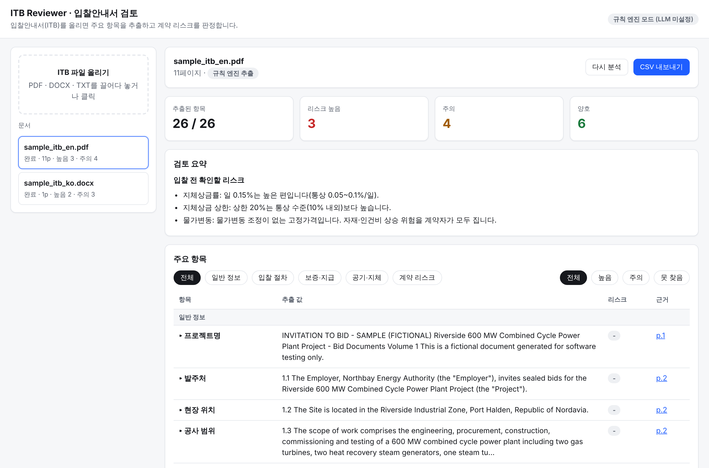

# ITB Reviewer · 입찰안내서 검토 서비스

입찰안내서(ITB, Invitation to Bid)를 올리면 주요 항목 26개를 추출하고, 계약자 입장의 리스크를 판정하고,
문서에 대해 질문할 수 있는 웹 서비스입니다.

AWS Summit Seoul 2025 발표 「AI 기반 대용량 문서 분석 업무: 삼성 입찰 안내서 분석 서비스」
(삼성물산 건설부문 × AWS)에서 공개된 개념을 바탕으로 기능을 재구성했습니다.
이 저장소의 코드는 발표 내용과 공개 기사를 참고해 새로 작성한 것으로, 삼성물산 시스템의 코드나 데이터를 포함하지 않습니다.

| 발표에서 공개된 개념 | 이 구현 |
|---|---|
| 수천 장 입찰안내서 처리 | PDF·DOCX·TXT 파싱, 페이지·조항 단위 청크, 한·영 BM25 색인 |
| 주요 정보 추출 | 5개 분류 26개 검토 항목 (입찰 일정, 보증, 지체상금, 하자담보, 책임 한도, 물가변동 등) |
| Agentic RAG 대화형 검토 | Claude가 `search_document` · `read_pages` · `get_extracted_items` 도구를 스스로 반복 호출해 답변, 모든 답에 페이지 근거 |
| 의사결정 지원 | 항목별 리스크(높음/주의/양호) 판정과 사유, 입찰 전 확인할 리스크 목록, CSV 내보내기 |



## 동작 방식

```
업로드 → 파싱(페이지/표) → 청크·조항 제목 → BM25 색인
      → 규칙 엔진: 항목별 검색 → 근거 문장 선택 → 값(날짜·%·기간) 추출 → 리스크 규칙
      → (API 키가 있으면) Claude: 항목별 근거 발췌를 읽고 구조화 JSON으로 값·요약·리스크 확정
질문 → Claude 에이전트 루프(검색 ↔ 페이지 열람, 최대 8회) → 페이지 인용 답변
       (키가 없으면 관련 조항 핵심 문장 발췌)
```

- **규칙 엔진만으로도 동작합니다.** API 키 없이도 추출·리스크 판정·발췌 검색이 됩니다.
- **Claude 모드**(`ANTHROPIC_API_KEY` 설정 시): 기본 모델 `claude-opus-5-5`, effort `medium`.
  규칙 엔진 값은 Claude에게 힌트로 주고, 화면에서 Claude 값과 규칙 값이 다르면 함께 표시합니다.
  안전 분류기 거절에 대비해 서버측 대체 모델(`fallbacks: "default"`)을 켜 두었습니다. 끄려면 `ITB_FALLBACKS=0`.

## 실행

```bash
cd itb_reviewer
pip install -r requirements.txt
python samples/make_samples.py          # 가상 샘플 ITB 2개 생성 (선택)
export ANTHROPIC_API_KEY=sk-ant-...     # 선택: Claude 모드
uvicorn itb.main:app --host 0.0.0.0 --port 8000
```

브라우저에서 http://localhost:8000 을 열고 ITB 파일을 올리면 됩니다.

| 환경 변수 | 기본값 | 설명 |
|---|---|---|
| `ANTHROPIC_API_KEY` | (없음) | 설정하면 Claude 추출·에이전트 답변 사용 |
| `ITB_MODEL` | `claude-opus-5-5` | 사용할 Claude 모델 |
| `ITB_EFFORT` | `medium` | `low`~`max`. 대용량 문서는 `high` 권장 |
| `ITB_FALLBACKS` | `1` | 거절 시 서버측 대체 모델 사용 (Claude API 전용) |

## API

| 메서드 | 경로 | 설명 |
|---|---|---|
| POST | `/api/documents` | 파일 업로드 (multipart `file`), 백그라운드 분석 시작 |
| GET | `/api/documents` | 문서 목록과 진행 상태 |
| GET | `/api/documents/{id}` | 추출 결과 (항목·값·근거·페이지·리스크) |
| POST | `/api/documents/{id}/reanalyze` | 다시 분석 |
| GET | `/api/documents/{id}/pages/{n}` | 페이지 원문 |
| POST | `/api/documents/{id}/chat` | `{"question": "...", "history": [...]}` 질의응답 |
| GET | `/api/documents/{id}/export.csv` | 엑셀용 CSV |

## 테스트

```bash
python -m pytest -q
```

규칙 엔진(영문 PDF·국문 DOCX), API 흐름, Claude 추출 병합과 에이전트 도구 루프(가짜 클라이언트)를 검증합니다.

## 한계와 다음 단계

- 스캔 이미지 PDF는 OCR이 먼저 필요합니다 (예: Amazon Textract, Tesseract).
- 리스크 기준값(지체상금 10%, 하자담보 12~24개월 등)은 업계 통상치를 넣어 둔 것이라 회사 기준에 맞게 `itb/rules.py`의 `assess_risk`를 조정해야 합니다.
- 문서·결과는 메모리와 `data/` 폴더에 저장됩니다. 운영 환경에서는 DB·객체 저장소와 인증을 붙여야 합니다.
- 수천 페이지 문서는 BM25에 임베딩 검색(하이브리드)을 더하면 동의어·의역 검색이 좋아집니다.
